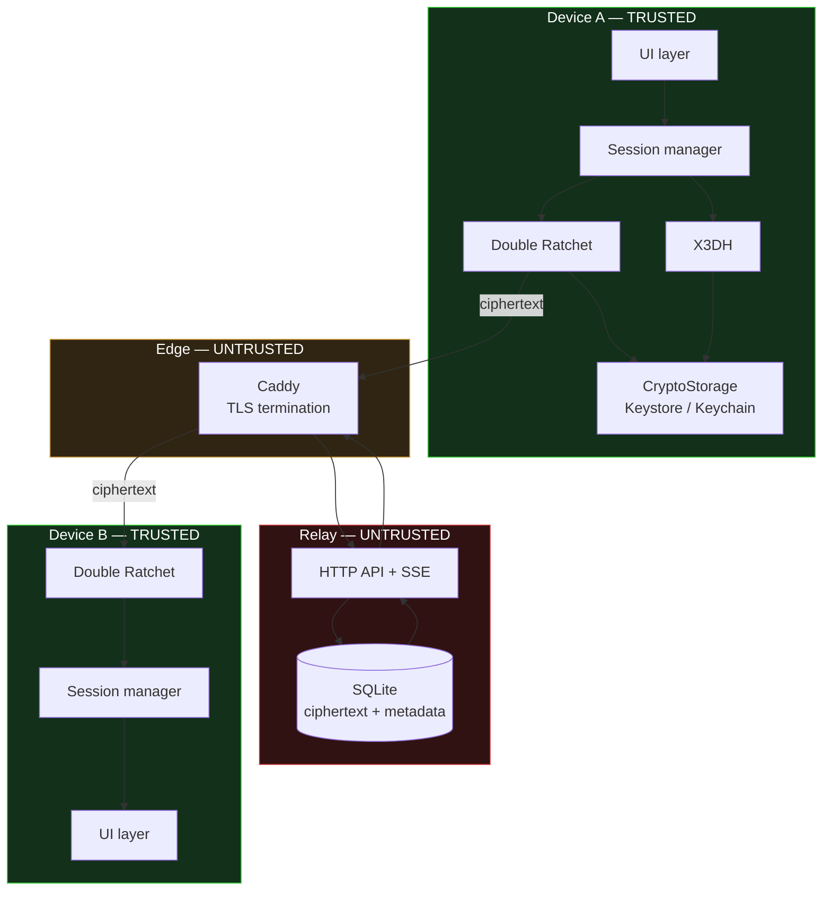

# Architecture

## System



## Layering

```
Identity (Ed25519 sig + X25519 DH)
  └─> X3DH session establishment       ← PQXDH-replaceable seam
        └─> Double Ratchet
              └─> per-message keys
                    └─> AES-256-GCM AEAD
                          └─> envelope
                                └─> HTTPS transport
```

Each layer knows only about the one below it. The Double Ratchet consumes a
32-byte secret and does not know it came from X3DH — which is exactly what
makes PQXDH a drop-in replacement.

## Repository

```
helo/
├── README.md  PROTOCOL.md  THREAT_MODEL.md  ARCHITECTURE.md
├── SECURITY_CLAIMS.md  PRIVACY.md  RESEARCH_METHODOLOGY.md
│
├── crypto/reference/helo_ref/   NORMATIVE Python implementation
│   ├── primitives.py    audited-library wrappers, key validation
│   ├── encoding.py      canonical wire encoding
│   ├── identity.py      identity, fingerprints, safety numbers
│   ├── prekeys.py       prekey lifecycle
│   ├── x3dh.py          session establishment + PQXDH seam
│   ├── ratchet.py       Double Ratchet
│   ├── message.py       envelope + data classification
│   ├── session.py       state machine + encrypted persistence
│   ├── secure_log.py    allowlist redacting logger
│   └── errors.py        fail-closed error taxonomy
│
├── backend/             relay — ZERO npm dependencies
│   ├── src/{db,auth,validate,ratelimit,log,server}.js
│   └── test/relay.test.js
│
├── mobile/              Flutter client
│   ├── lib/crypto/      Dart port of the reference
│   ├── lib/storage/     CryptoStorage platform abstraction
│   ├── lib/security/    secure logging
│   ├── android/ ios/ web/ windows/   generated platform projects
│   └── test/{vector_conformance,session_manager}_test.dart
│
├── tests/{unit,adversarial,property,integration,vectors}/
├── scripts/{generate_test_vectors,benchmark,integration_e2e,run_demo}.py
├── docker/{Dockerfile,docker-compose.yml,Caddyfile}
└── .github/workflows/ci.yml
```

## Why the reference implementation is Python

The Python package is **normative**; the Dart client is a port checked against
it. This is not an accident of tooling — it is the verification strategy.

A second implementation of a cryptographic protocol is rarely wrong in a way
that crashes. It is wrong in a way that derives a *different key* while looking
perfectly healthy in isolation: a swapped DH order, a missing `0xFF` prefix, a
differing HKDF info string, big-endian versus little-endian counters. Two
implementations that only ever talk to themselves will both pass their own
tests and fail to interoperate.

`scripts/generate_test_vectors.py` pins every intermediate value. The Dart
suite replays them. That is the mechanism that makes the port verifiable rather
than merely plausible. It has caught real defects in both directions — among
them a Dart safety number that disagreed with the reference for about a third
of identity pairs (see RESEARCH_METHODOLOGY.md, "Defects found").

## Why the relay has zero dependencies

The relay handles ciphertext for every user and is the richest single source of
metadata in the system. Every npm dependency is a supply-chain path into it. An
empty dependency tree cannot be poisoned, so the relay uses only `node:http`,
`node:crypto`, and `node:sqlite`. CI fails the build if a dependency is ever
added.

## Structural enforcement of the trust boundary

The relay does not import protocol code. It cannot perform X3DH, holds no
ratchet state, and contains no AES call anywhere in `backend/src/`. Its entire
relationship with a message is: validate shape and size, store bytes, hand bytes
to the recipient, delete bytes.

This is enforced by construction rather than by policy — there is no column in
the schema capable of holding plaintext or a session key, and the envelope
validator *rejects unknown fields*, so a future client bug attaching a plaintext
preview is refused at the boundary rather than silently stored.
