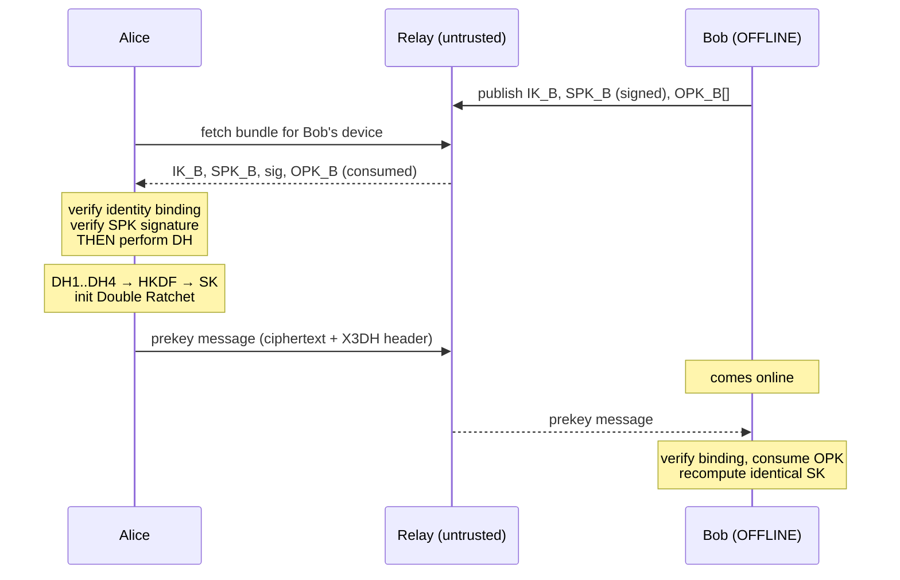

# Helo Protocol Specification

`Helo/1 X3DH-Curve25519-SHA256 + DoubleRatchet + AES-256-GCM`

**Not post-quantum secure.** The normative implementation is
`crypto/reference/helo_ref/`. Where any other implementation disagrees with it,
the other implementation is wrong.

## 1. Primitives

| Purpose | Algorithm | Standard |
|---|---|---|
| Key agreement | X25519 | RFC 7748 |
| Signatures | Ed25519 | RFC 8032 |
| Hash | SHA-256 | FIPS 180-4 |
| MAC / chain ratchet | HMAC-SHA-256 | RFC 2104 |
| KDF | HKDF-SHA-256 | RFC 5869 |
| AEAD | AES-256-GCM | NIST SP 800-38D |

## 2. Domain separation

Every KDF invocation carries a distinct, versioned info string. Reusing one
across contexts is a protocol bug.

```
Helo_X3DH_v1              X3DH shared-secret derivation
Helo_RootRatchet_v1       root KDF
Helo_MessageKeys_v1       message key -> (aes_key, nonce)
Helo_Fingerprint_v1       identity fingerprint and safety number
Helo_IdentityBinding_v1   IK_sig attests to IK_dh
Helo_SignedPreKey_v1      signed prekey signature
Helo_SessionId_v1         session identifier
Helo_AD_v1                AEAD associated data
Helo_SessionStateKey_v1   encrypted state persistence
```

**These strings are part of the protocol.** Changing one changes every derived
key. See README § "A note on the protocol name".

## 3. Identity

An identity is **two** key pairs:

```
IK_sig   Ed25519   signatures only
IK_dh    X25519    key agreement only
```

This deviates from Signal, which uses one Curve25519 key for both via XEdDSA.
Rationale and cost are in README § "Two deliberate deviations".

Binding: `IK_sig` signs `Helo_IdentityBinding_v1 ‖ IK_dh_pub`.

Canonical encoding, used in fingerprints and AEAD associated data:

```
encode(identity) = u8(1) ‖ lp(IK_sig_pub) ‖ lp(IK_dh_pub)
```

where `lp(x)` = big-endian uint16 length ‖ x.

Fingerprint: 5200 iterations of `SHA256(digest ‖ encode(identity))`, seeded
with `Helo_Fingerprint_v1 ‖ encode(identity)`.

Safety number: both fingerprints sorted, hashed, rendered as twelve 5-digit
groups (60 digits). Order-independent, so both users see the same string.

## 4. X3DH



```
DH1 = DH(IK_A.dh, SPK_B)     binds Alice's identity to Bob's signed prekey
DH2 = DH(EK_A,    IK_B.dh)   binds Bob's identity to Alice's ephemeral
DH3 = DH(EK_A,    SPK_B)     forward secrecy from the ephemeral
DH4 = DH(EK_A,    OPK_B)     forward secrecy from the one-time prekey (optional)

SK = HKDF-SHA256(ikm  = F ‖ DH1 ‖ DH2 ‖ DH3 [‖ DH4],
                 salt = 0x00 × 32,
                 info = "Helo_X3DH_v1",
                 L    = 32)

F = 0xFF × 32
```

Mutual authentication comes from DH1 and DH2. Signature verification happens
**before** any DH: a bundle that fails validation never touches a private key.

The ephemeral private key is used for three DH operations and then discarded.
It is deliberately not returned from the handshake — returning it would invite
a caller to persist it, destroying the forward secrecy it exists to provide.

**Associated data**, fed into *every* AEAD operation in the session:

```
AD = "Helo_AD_v1" ‖ encode(IK_initiator) ‖ encode(IK_responder)
```

Order is always (initiator, responder), never sorted — fixing the order
prevents an attacker reflecting a message back at its own sender.

Both identities are therefore bound to every message, not merely the handshake.

## 5. Double Ratchet

**Initialisation**
- *Initiator:* `DHr = SPK_B`; generate `DHs`; `RK, CKs = KDF_RK(SK, DH(DHs, DHr))`
- *Responder:* `RK = SK`; `DHs = SPK_B` key pair; no chains until first receive

**Root KDF** — current root key is the *salt*, DH output is the *IKM*:
```
RK', CK = HKDF-SHA256(ikm=dh_out, salt=RK, info="Helo_RootRatchet_v1", L=64)
```

**Chain KDF:**
```
MK      = HMAC-SHA256(CK, 0x01)
CK_next = HMAC-SHA256(CK, 0x02)
```

**Message key expansion:**
```
aes_key ‖ nonce = HKDF-SHA256(ikm=MK, salt=0x00×32,
                              info="Helo_MessageKeys_v1", L=44)
```

The nonce is **derived, not transmitted**. See README § "Two deliberate
deviations".

**Bounds:** `MAX_SKIP = 1000` per chain, `MAX_SKIPPED_KEYS = 2000` per session,
checked *before* derivation.

**Atomicity:** decryption operates on a copy of the state and commits only on
success.

## 6. Wire format

**Ratchet header — 41 bytes, authenticated but not encrypted:**
```
u8(version) ‖ dh_pub[32] ‖ u32(pn) ‖ u32(n)
```

**Envelope (JSON over HTTPS):**
```json
{
  "v": 1,
  "type": "prekey" | "normal",
  "session_id": "<hex>",
  "sender_device_id": "<id>",
  "header": "<base64, 41 bytes>",
  "ciphertext": "<base64, ciphertext ‖ 16-byte GCM tag>",
  "x3dh": { ... }
}
```

No `nonce` field. `x3dh` is present on `prekey` messages only; a `normal`
message carrying one is rejected.

**Ciphertext expansion: constant 57 bytes** (16 tag + 41 header) at every
payload size — measured, 0 B to 16 KB. Constant expansion means ciphertext
length reveals plaintext length exactly.

## 7. State machine

```
UNINITIALIZED → IDENTITY_CREATED → PREKEY_PUBLISHED → SESSION_ESTABLISHED
                                                            ↓
                                        SESSION_ACTIVE ⇄ RATCHETING
                                                            ↓
                                                     SESSION_REVOKED (terminal)
```

Invalid transitions raise `InvalidStateTransitionError`. `SESSION_REVOKED` is
terminal by design — "recover by resetting the state" is how implementations
accidentally build a downgrade path.

## 8. Failure handling

Every failure raises a typed error. **No path degrades to plaintext.**

| Condition | Result |
|---|---|
| AEAD tag mismatch | `AuthenticationError` — reject |
| Consumed message key | `ReplayError` — reject |
| Bad prekey signature | `SignatureVerificationError` — reject bundle |
| Peer identity changed | `IdentityChangedError` — warn, refuse |
| Counter beyond bound | `TooManySkippedMessagesError` — reject |
| Corrupt stored state | `SessionStateCorruptError` — require re-establishment |
| Low-order curve point | `InvalidKeyError` — reject |

## 9. PQXDH migration

`x3dh.KeyEstablishment` is the seam. The Double Ratchet consumes only
`X3DHResult.shared_secret` and knows nothing of its origin, so migration
touches exactly one module:

1. Publish an ML-KEM-768 public key in the bundle, signed by `IK_sig`.
2. `initiate` encapsulates; the KEM ciphertext travels in the initial header.
3. `respond` decapsulates.
4. The KEM secret is **concatenated with** the classical DH outputs — hybrid,
   so a break in either primitive alone is not fatal.
5. `Helo_X3DH_v1` becomes `Helo_PQXDH_v1` so the schemes cannot collide.

Nothing in the ratchet or envelope layers changes.
