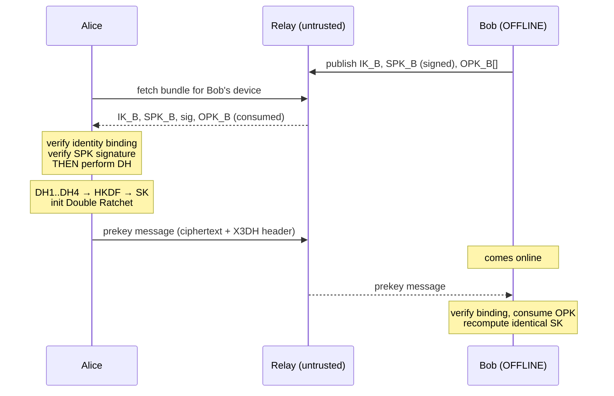

# Helo Protocol Specification

`Helo/2 PQXDH(X25519 + ML-KEM-768)-SHA256 + DoubleRatchet + AES-256-GCM`
(classical `Helo/1 X3DH` remains defined, and is accepted only when a user explicitly allows it)

**Post-quantum at session establishment only.** The hybrid handshake (§ 9) protects each session's
initial secret against a future quantum adversary. The Double Ratchet that follows is classical. The
normative implementation is
`crypto/reference/helo_ref/`. Where any other implementation disagrees with it,
the other implementation is wrong.

## 1. Primitives

| Purpose | Algorithm | Standard |
|---|---|---|
| Key agreement | X25519 | RFC 7748 |
| Signatures | Ed25519 | RFC 8032 |
| Hash | SHA-256 | FIPS 180-4 |
| MAC / chain ratchet | HMAC-SHA-256 | RFC 2104 |
| KDF | HKDF-SHA-256 | RFC 5869 |
| AEAD | AES-256-GCM | NIST SP 800-38D |
| KEM (hybrid establishment) | ML-KEM-768 | FIPS 203 |

## 2. Domain separation

Every KDF invocation carries a distinct, versioned info string. Reusing one
across contexts is a protocol bug.

```
Helo_X3DH_v1              X3DH shared-secret derivation
Helo_RootRatchet_v1       root KDF
Helo_MessageKeys_v1       message key -> (aes_key, nonce)
Helo_Fingerprint_v1       identity fingerprint and safety number
Helo_IdentityBinding_v1   IK_sig attests to IK_dh
Helo_SignedPreKey_v1      signed prekey signature
Helo_SessionId_v1         session identifier
Helo_AD_v1                AEAD associated data
Helo_SessionStateKey_v1   encrypted state persistence
```

**These strings are part of the protocol.** Changing one changes every derived
key. See README § "A note on the protocol name".

## 3. Identity

An identity is **two** key pairs:

```
IK_sig   Ed25519   signatures only
IK_dh    X25519    key agreement only
```

This deviates from Signal, which uses one Curve25519 key for both via XEdDSA.
Rationale and cost are in README § "Two deliberate deviations".

Binding: `IK_sig` signs `Helo_IdentityBinding_v1 ‖ IK_dh_pub`.

Canonical encoding, used in fingerprints and AEAD associated data:

```
encode(identity) = u8(1) ‖ lp(IK_sig_pub) ‖ lp(IK_dh_pub)
```

where `lp(x)` = big-endian uint16 length ‖ x.

Fingerprint: 5200 iterations of `SHA256(digest ‖ encode(identity))`, seeded
with `Helo_Fingerprint_v1 ‖ encode(identity)`.

Safety number: both fingerprints sorted, hashed, rendered as twelve 5-digit
groups (60 digits). Order-independent, so both users see the same string.

## 4. X3DH



```
DH1 = DH(IK_A.dh, SPK_B)     binds Alice's identity to Bob's signed prekey
DH2 = DH(EK_A,    IK_B.dh)   binds Bob's identity to Alice's ephemeral
DH3 = DH(EK_A,    SPK_B)     forward secrecy from the ephemeral
DH4 = DH(EK_A,    OPK_B)     forward secrecy from the one-time prekey (optional)

SK = HKDF-SHA256(ikm  = F ‖ DH1 ‖ DH2 ‖ DH3 [‖ DH4],
                 salt = 0x00 × 32,
                 info = "Helo_X3DH_v1",
                 L    = 32)

F = 0xFF × 32
```

Mutual authentication comes from DH1 and DH2. Signature verification happens
**before** any DH: a bundle that fails validation never touches a private key.

The ephemeral private key is used for three DH operations and then discarded.
It is deliberately not returned from the handshake — returning it would invite
a caller to persist it, destroying the forward secrecy it exists to provide.

**Associated data**, fed into *every* AEAD operation in the session:

```
AD = "Helo_AD_v1" ‖ encode(IK_initiator) ‖ encode(IK_responder)
```

Order is always (initiator, responder), never sorted — fixing the order
prevents an attacker reflecting a message back at its own sender.

Both identities are therefore bound to every message, not merely the handshake.

## 5. Double Ratchet

**Initialisation**
- *Initiator:* `DHr = SPK_B`; generate `DHs`; `RK, CKs = KDF_RK(SK, DH(DHs, DHr))`
- *Responder:* `RK = SK`; `DHs = SPK_B` key pair; no chains until first receive

**Root KDF** — current root key is the *salt*, DH output is the *IKM*:
```
RK', CK = HKDF-SHA256(ikm=dh_out, salt=RK, info="Helo_RootRatchet_v1", L=64)
```

**Chain KDF:**
```
MK      = HMAC-SHA256(CK, 0x01)
CK_next = HMAC-SHA256(CK, 0x02)
```

**Message key expansion:**
```
aes_key ‖ nonce = HKDF-SHA256(ikm=MK, salt=0x00×32,
                              info="Helo_MessageKeys_v1", L=44)
```

The nonce is **derived, not transmitted**. See README § "Two deliberate
deviations".

**Bounds:** `MAX_SKIP = 1000` per chain, `MAX_SKIPPED_KEYS = 2000` per session,
checked *before* derivation.

**Atomicity:** decryption operates on a copy of the state and commits only on
success.

## 6. Wire format

**Ratchet header — 41 bytes, authenticated but not encrypted:**
```
u8(version) ‖ dh_pub[32] ‖ u32(pn) ‖ u32(n)
```

**Envelope (JSON over HTTPS):**
```json
{
  "v": 1,
  "type": "prekey" | "normal",
  "session_id": "<hex>",
  "sender_device_id": "<id>",
  "header": "<base64, 41 bytes>",
  "ciphertext": "<base64, ciphertext ‖ 16-byte GCM tag>",
  "x3dh": { ... }
}
```

No `nonce` field. `x3dh` is present on `prekey` messages only; a `normal`
message carrying one is rejected.

**Ciphertext expansion: constant 57 bytes** (16 tag + 41 header) at every
payload size — measured, 0 B to 16 KB. Constant expansion means ciphertext
length reveals the *encrypted* length exactly; in Helo/2 that is the padded
length (§ 10), not the message length.

## 7. State machine

```
UNINITIALIZED → IDENTITY_CREATED → PREKEY_PUBLISHED → SESSION_ESTABLISHED
                                                            ↓
                                        SESSION_ACTIVE ⇄ RATCHETING
                                                            ↓
                                                     SESSION_REVOKED (terminal)
```

Invalid transitions raise `InvalidStateTransitionError`. `SESSION_REVOKED` is
terminal by design — "recover by resetting the state" is how implementations
accidentally build a downgrade path.

## 8. Failure handling

Every failure raises a typed error. **No path degrades to plaintext.**

| Condition | Result |
|---|---|
| AEAD tag mismatch | `AuthenticationError` — reject |
| Consumed message key | `ReplayError` — reject |
| Bad prekey signature | `SignatureVerificationError` — reject bundle |
| Peer identity changed | `IdentityChangedError` — warn, refuse |
| Counter beyond bound | `TooManySkippedMessagesError` — reject |
| Corrupt stored state | `SessionStateCorruptError` — require re-establishment |
| Low-order curve point | `InvalidKeyError` — reject |

## 9. Hybrid establishment (PQXDH) — Helo/2

Implemented in `helo_ref/pqxdh.py` (normative) and `mobile/lib/crypto/pqxdh.dart`, with vectors in the
`pqxdh` section and `tests/vectors/pqxdh_encapsulation_fixture.json`. It follows the structure of
Signal's PQXDH. This instantiation (a separate Ed25519 signing key, ML-KEM-768, our own encodings) has
**not** been formally analysed.

**PQ prekeys.** Each device publishes signed ML-KEM-768 encapsulation keys: one-time keys (20 per batch)
and one last-resort key.
```
Encode(PQPK) = 0x01 (KEM id: ML-KEM-768) ‖ ek[1184]
sig          = Ed25519(IK_sig, "Helo_PQPreKey_v1" ‖ u32(key_id) ‖ lp(Encode(PQPK)))
```
The relay serves one PQ one-time key per bundle fetch while any remain, and the last-resort key after that.

**Initiator.** Before any DH or encapsulation, the initiator verifies the identity binding, the SPK
signature and the PQPK signature. Then:
```
(CT, SS) = ML-KEM-768.Encaps(PQPK_B)
SK = HKDF-SHA256(ikm  = F ‖ DH1 ‖ DH2 ‖ DH3 [‖ DH4] ‖ SS,  salt = 0x00*32,
                 info = "Helo_PQXDH_X25519_SHA-256_ML-KEM-768_v1", L = 32)
```
The info string differs from `Helo_X3DH_v1`, so classical and hybrid sessions cannot derive the same key.
To learn SK, an attacker must break both X25519 and ML-KEM-768.

**Initial header v2.** The header gains `"version": 2` and `"pq": {"key_id": n, "ct": base64(CT[1088])}`.
A v1 header that carries `pq`, or a v2 header that lacks it, is rejected as malformed; it is never repaired
into either mode.

**Downgrade policy (no silent fallback).**
- An initiator that is given a bundle without a valid PQ prekey raises `PostQuantumUnavailableError`.
- A responder whose policy requires the hybrid rejects a classical initial message with
  `DowngradeRejectedError`.
- Classical sessions exist only if the user turns on *Settings → Allow classical-only contacts* (after a confirmation). The app then labels the
  session "Classical" in the chat header.
- Editing the header in transit makes the two sides derive different SKs, so the first message fails
  authentication.

**Cost** (measured, `research/RESULTS.md` E2): about 0.2 ms more per side in the Python reference. The
first envelope is +1.5 KB, the bundle +1.7 KB, and a full prekey upload +36 KB.

## 10. Padding (Helo/2)

The encrypted plaintext is padded before the ratchet encrypts it (ISO/IEC 7816-4 style):
```
padded = payload ‖ 0x80 ‖ 0x00 … 0x00      (length = policy(len(payload) + 1))
```
- **Policies:** `none`, `block-160`, `block-256` (the default), `pow2-256`, `padme`. All are capped at
  64 KiB − 16.
- **Unpadding:** strip trailing zeros, then require 0x80. Anything else is `InvalidEncodingError`.
- Because the AEAD expansion is constant, the relay sees only the padded size. E1 measures the leakage per
  policy.

## 11. Attachments (Helo/2)

- **Content:** a fresh random 32-byte key per file, encrypted with STREAM over AES-256-GCM.
  - The file is split into 64 KiB chunks.
  - `nonce_i = 0x00*7 ‖ u32_be(i) ‖ u8(is_final)`, `AD = "Helo_Attachment_v1"`.
  - Maximum size is 24 MiB of plaintext.
- **Upload:** the ciphertext goes to `POST /attachments`, which also lists the recipient devices.
- **Key delivery:** `{id, key, digest = SHA-256(ciphertext), size, mime, name, chunk}` travels only
  inside an end-to-end encrypted message.
- **Rejection:**
  - a substituted blob fails the digest check before any decryption;
  - reordered, truncated or extended ciphertext fails authentication.

## 12. Application payload (Helo/2)

Everything a user does travels as one AEAD-protected JSON object (`mobile/lib/protocol/payload.dart`),
which is padded as in § 10:
```
{"v": 1, "id": <random id>, "ts": <ms>, "k": msg|react|edit|del|rcpt|typing|profile|timer|group,
 "conv": {"t": "d"} | {"t": "g", "gid": ...}, ...kind-specific fields}
```
The relay therefore cannot tell a message from a receipt, a typing indicator, a reaction, an edit or a
group change, apart from their padded sizes.

Attachment references may carry two optional fields:
- `"voice": true` marks a recorded voice message, which must have an `audio/*` MIME type;
- `"dur": <ms>` is the sender-measured length, 0 to 600000, for display only.

Receivers reject any other value, and treat a missing field as false/unknown, so older clients interoperate.
An empty `body` is valid when the message has attachments: an uncaptioned file.

**Verification codes.** A device displays `helo:v1:<b64(Encode(own identity))>:<b64(Encode(the identity it
holds for the viewer))>`. The scanner compares both halves byte for byte with what it already holds
(`check_qr_payload`, pinned by the `qr_check` vectors):
- **MATCH** only if both halves are equal. That device alone is marked verified, and nothing is ever imported.
- **PEER_KEY_MISMATCH** if the code's owner is not the key held for that contact.
- **OWN_KEY_MISMATCH** if the peer holds a different key for the scanner; this is the man-in-the-middle signal.
- **NOT_HELO** for anything else, including codes over 512 characters.

Receivers enforce authorisation themselves:
- only the author may edit or delete a message (edits within 15 min, deletes for everyone within 48 h);
- only group admins may change a group, and the group snapshot is versioned;
- the author of a message is the session's authenticated peer, never a field in the payload.
