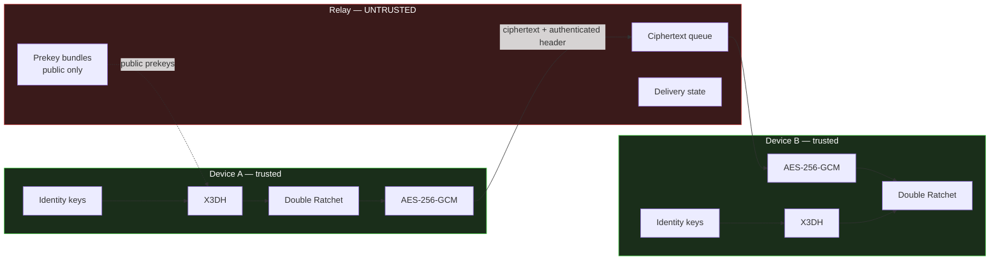

# Helo

**Classical X3DH + Double Ratchet implementation** with an untrusted ciphertext
relay architecture.

Protocol identifier: `Helo/1 X3DH-Curve25519-SHA256 + DoubleRatchet + AES-256-GCM`

> **Not post-quantum secure.** No post-quantum primitive exists in this
> codebase. The key-establishment layer is abstracted so PQXDH can replace it
> — see [PQXDH roadmap](#pqxdh-roadmap) — but until that work is done and
> tested, no PQ property is claimed.

---

## A note on the protocol name

The name is not cosmetic. It is embedded in every KDF domain-separation string
(`Helo_X3DH_v1`, `Helo_RootRatchet_v1`, `Helo_MessageKeys_v1`, and so on), so
**changing it changes every key the protocol derives.** Verified: regenerating
the vectors from the identical seed after the rename produced a different root
key, a different message key, and a different X3DH shared secret at every
pinned step.

That is domain separation working correctly — it is what stops key material
from one context being reusable in another. It also means the name is now
frozen: renaming again after any deployment would break every existing session
and invalidate every stored vector. Any future change must go through a
protocol version bump, not a string edit.

---

## Status

This project is being built in the phased order its specification prescribes:
**cryptography first, chat UI last.** A polished UI over an unverified protocol
is the exact failure mode this design is meant to avoid.

| Phase | Component | Status |
|---|---|---|
| 1 | Repository & architecture | ✅ Complete |
| 2 | Cryptographic abstraction layer | ✅ Complete |
| 3 | Identity keys & secure storage | ✅ Complete (in-memory storage tested; platform keystores not exercised) |
| 4 | Prekey infrastructure | ✅ Complete |
| 5 | X3DH session establishment | ✅ Complete |
| 6 | Double Ratchet | ✅ Complete |
| 7 | Message encryption | ✅ Complete |
| 8 | Relay backend | ✅ Complete — 25 tests, zero dependencies |
| 9 | Flutter client | ✅ Crypto, storage, relay client, UI — runs in the browser |
| 10 | Identity verification | ✅ Protocol, safety numbers, QR display + warning UI |
| 11–13 | Security, adversarial, property testing | ✅ 99 tests passing |
| 14 | Documentation | ✅ Complete |
| 15 | CI/CD & deployment | ✅ Complete — CI, Docker, TLS |

**Verification status by component — this distinction matters:**

| Component | Executed & verified here? |
|---|---|
| Python reference implementation | ✅ 99 tests run and passing |
| Relay backend | ✅ 25 tests run and passing |
| Cross-stack end-to-end | ✅ 24 checks run and passing |
| Test vectors | ✅ reproduce byte-exactly |
| Dart client crypto | ✅ 22 vector-conformance tests passing (Flutter 3.47 / Dart 3.13) |
| Dart client session layer | ✅ 6 tests: restarts, token expiry, crash-before-send, forged first message |
| Web client against the real relay | ✅ exercised by hand: two users, restart, ratchet, verification |
| Android / iOS builds | ⚠️ platform projects generated, not built (no Android SDK or macOS here) |

The Dart port is *verifiable*, not asserted correct: `flutter test` replays the
vectors the Python reference generates, and a single differing byte fails it.
Running it caught a real defect the original vectors could not: the Dart safety
number ordered fingerprints by their **base64 text** rather than their bytes,
which disagrees with the reference for roughly a third of identity pairs. A
vector chosen to sort differently under the two rules now pins the behaviour
(`safety_number_ordering` in the vector file).

**What exists today**: a verified cryptographic core, a working untrusted
relay, a Flutter client that runs in the browser against that relay, complete
documentation and threat modelling, CI, and containerised deployment.

**How to run any of it: [RUNNING.md](RUNNING.md).**

---

## Security philosophy

Three commitments shape every design decision here:

1. **Claim nothing that is not tested.** Every security property is mapped to a
   named passing test in [SECURITY_CLAIMS.md](SECURITY_CLAIMS.md). Properties
   that are intended but undemonstrated are listed separately as *not claimed*.

2. **State limitations as prominently as capabilities.** Forward secrecy has two
   real exceptions in this design; both have **dedicated tests asserting the
   exception**, not just a footnote. The relay sees substantial metadata; it is
   enumerated field by field.

3. **Never describe the backend as "zero knowledge."** It is an *untrusted
   ciphertext relay that does not possess plaintext message content or session
   encryption keys.* That is a narrower and truthful statement.

---

## Architecture



The red boundary is the trust boundary. Everything inside it is assumed hostile.

### Protocol layers

```
Identity (Ed25519 sig + X25519 DH)
   └─> X3DH session establishment        [PQXDH-replaceable seam]
         └─> Double Ratchet
               └─> per-message keys
                     └─> AES-256-GCM AEAD
                           └─> ciphertext transport
```

### Cryptographic primitives

| Purpose | Algorithm | Standard |
|---|---|---|
| Key agreement | X25519 | RFC 7748 |
| Signatures | Ed25519 | RFC 8032 |
| Hash | SHA-256 | FIPS 180-4 |
| MAC / chain ratchet | HMAC-SHA-256 | RFC 2104 |
| KDF | HKDF-SHA-256 | RFC 5869 |
| AEAD | AES-256-GCM | NIST SP 800-38D |

No primitive is hand-implemented. `primitives.py` is a thin wrapper over
`cryptography` (OpenSSL bindings); its only original logic is domain
separation, key validation, and an injectable randomness source for
reproducible vectors.

---

## Two deliberate deviations

Both are documented in code with their rationale, because unexplained
deviations from a well-known protocol are how subtle breaks get introduced.

**1. Split identity key.** Signal uses one Curve25519 key for both DH and
signing via XEdDSA. Helo uses `IK_sig` (Ed25519) + `IK_dh` (X25519).
XEdDSA has no mainstream Dart implementation and hand-rolling it would violate
the "no custom primitives" rule; cross-algorithm key reuse is also generally
discouraged. The two halves are bound by a signature, by the fingerprint, and
by the AEAD associated data — substituting either breaks all three at once.

**2. Derived AEAD nonce.** The nonce is derived from the message key via HKDF
rather than randomly generated and transmitted. AES-GCM fails catastrophically
on nonce reuse; with a random nonce that safety depends on the sender's RNG
being healthy at every send, whereas with derivation it depends only on each
message key being used once — which the ratchet guarantees structurally. This
converts a runtime assumption into a structural one and saves 12 bytes per
message.

---

## Repository structure

```
helo/
├── README.md
├── SECURITY_CLAIMS.md          claim → mechanism → test → evidence → limitation
├── crypto/reference/           NORMATIVE Python protocol implementation
│   └── helo_ref/
│       ├── primitives.py       audited-library wrappers, key validation
│       ├── encoding.py         canonical wire encoding
│       ├── identity.py         identity keys, fingerprints, safety numbers
│       ├── prekeys.py          prekey lifecycle
│       ├── x3dh.py             session establishment + PQXDH seam
│       ├── ratchet.py          Double Ratchet
│       ├── message.py          wire envelope + data classification
│       ├── session.py          state machine + encrypted persistence
│       ├── secure_log.py       allowlist-based redacting logger
│       └── errors.py           fail-closed error taxonomy
├── tests/
│   ├── unit/                   47 tests
│   ├── adversarial/            29 tests
│   ├── property/               13 tests (Hypothesis)
│   ├── integration/            10 tests
│   └── vectors/                deterministic cross-implementation vectors
├── scripts/
│   ├── generate_test_vectors.py
│   ├── integration_e2e.py      real relay + real client + database inspection
│   ├── run_demo.py             relay + web client for a local two-user demo
│   └── benchmark.py
├── docs/benchmarks/
├── backend/                    relay — ZERO npm dependencies
│   ├── src/{db,auth,validate,ratelimit,log,server}.js
│   └── test/relay.test.js      25 tests
├── mobile/                     Flutter client
│   ├── lib/crypto/             Dart port of the reference
│   ├── lib/storage/            CryptoStorage (Keystore / Keychain)
│   ├── lib/data/               relay client (moves ciphertext only)
│   ├── lib/domain/             SessionManager — the plaintext boundary
│   ├── lib/ui/                 screens and security-state widgets
│   ├── android/ ios/ web/ windows/   generated platform projects
│   └── test/                   vector conformance + SessionManager tests
├── docker/                     hardened deployment + TLS
└── .github/workflows/ci.yml    CI with security gates
```

The Python reference is **normative**. When the Dart client disagrees with it,
the Dart client is wrong. This is why the vectors exist: a second
implementation is rarely wrong in a way that crashes — it is wrong in a way
that derives a *different key* while looking perfectly healthy in isolation.

---

## Setup

Requires Python 3.11+.

```bash
pip install cryptography pytest hypothesis
```

## Testing

```bash
python3 -m pytest -q                      # 99 protocol tests
python3 -m pytest tests/adversarial -q    # active-attacker tests
python3 -m pytest tests/property -q       # property-based tests

cd backend && node --test test/relay.test.js   # 25 relay tests, zero deps
cd mobile  && flutter test                     # 28 Dart tests incl. vector conformance
```

## Security testing

```bash
python3 scripts/generate_test_vectors.py           # regenerate vectors
python3 scripts/generate_test_vectors.py --check   # byte-exact reproducibility
python3 scripts/integration_e2e.py                 # real relay + database inspection
python3 scripts/benchmark.py                       # measured performance
```

`integration_e2e.py` is the one to run if you only run one: it starts the real
relay, drives it with the real client over HTTP, then opens the relay's SQLite
file and scans the raw bytes for plaintext and key material.

## Web demo

```bash
cd mobile && flutter build web && cd ..
python3 scripts/run_demo.py --fresh
```

Starts the relay and serves the Flutter web client on two ports — open
`http://localhost:5000` (Alice) and `http://localhost:5001` (Bob). Each port is
a separate browser origin with its own key storage, so the two tabs are
genuinely different devices. Details in [RUNNING.md](RUNNING.md#4-web-demo).

## Deployment

```bash
cd docker && RELAY_DOMAIN=relay.example.com docker compose up -d --build
```

Read-only container, non-root, all capabilities dropped, relay off the public
network, TLS terminated by Caddy. See `docker/` and SECURITY.md.

---

## Measured results

Reference implementation, general-purpose machine. **These are not mobile
numbers** and are explicitly disclaimed as such in the benchmark script.

| Operation | Median | p95 |
|---|---|---|
| Identity key generation | 0.17 ms | 0.31 ms |
| Prekey bundle verification | 0.27 ms | 0.43 ms |
| X3DH session establishment | 0.85 ms | 1.25 ms |
| Message encryption (256 B) | 0.023 ms | 0.033 ms |
| Encrypt + decrypt round trip | 1.09 ms | 1.38 ms |
| DH ratchet step (both sides) | 5.66 ms | 6.35 ms |
| 100 one-time prekeys | 4.54 ms | 4.97 ms |

Run-to-run variance on a shared machine is roughly ±20%, so treat these as
*relative* costs — a DH ratchet step is ~250× a symmetric encryption, which is
the number that actually matters for design — not as precise figures.
Regenerate with `python3 scripts/benchmark.py`.

**Ciphertext expansion: constant 57 bytes** (16-byte GCM tag + 41-byte header)
across payloads from 0 B to 16 KB. Because expansion is constant, ciphertext
length reveals plaintext length exactly — a metadata consequence recorded in
SECURITY_CLAIMS.md rather than glossed over.

---

## Known limitations

The full list is in [SECURITY_CLAIMS.md](SECURITY_CLAIMS.md). The ones that
matter most:

- **Not post-quantum secure.** No PQ primitive is implemented.
- **Trust On First Use.** Cryptography authenticates keys, not people. A
  first-contact MITM is only detected if users actually compare safety numbers
  out of band.
- **Metadata is exposed.** No padding, cover traffic, or sealed sender. Traffic
  analysis is not defended against.
- **Post-compromise recovery is not automatic.** It requires the compromised
  party to actually send a message.
- **Forward secrecy has two exceptions**: in-flight messages and stored skipped
  keys. Both are asserted by tests.
- **Endpoint compromise defeats everything.** Memory zeroisation is best-effort.
- **Hardware backing is narrower than it sounds.** The Keystore/Keychain
  *wrapping* key is hardware-backed; the identity keys themselves are encrypted
  at rest but must exist in process memory to perform a DH. Spelled out
  precisely in `mobile/lib/storage/crypto_storage.dart`.
- **The Flutter client is verified in the browser, not on phones.** Its crypto
  passes the reference vectors and it has run end to end against the real
  relay as a web app. The Android and iOS builds have not been compiled, and
  on the web, `flutter_secure_storage` keeps keys in browser storage under a
  WebCrypto key — far weaker than a hardware keystore. The web build is a
  demonstration client, not a recommended way to hold real keys.
- **QR verification is display-only.** The app renders the verification QR
  code but cannot scan one; compare the 60-digit numbers instead.
- **A peer who resets their identity cannot be re-adopted in place.** The
  conversation is flagged *identity changed* and stays blocked; there is no
  "accept new key" flow yet.
- **Interoperability with Signal is not claimed** and has not been tested.

---

## PQXDH roadmap

`x3dh.KeyEstablishment` is the migration seam. The Double Ratchet consumes only
`X3DHResult.shared_secret` and has no knowledge of how it was produced, so
migration touches exactly one module:

1. Publish an ML-KEM-768 public key in the prekey bundle, signed by `IK_sig`.
2. `initiate` encapsulates against it; the KEM ciphertext travels in the initial
   header.
3. `respond` decapsulates.
4. The KEM shared secret is **concatenated with** the classical DH outputs in
   the HKDF input — a hybrid construction. The classical DHs are *retained*, so
   a break in either primitive alone is not fatal.
5. `INFO_X3DH` becomes `Helo_PQXDH_v1` so the schemes cannot derive
   colliding secrets.

Nothing in `ratchet.py` or `message.py` changes. That is the point of the seam.

---

## Responsible disclosure

This is a research and portfolio implementation. **It has not been
independently audited and should not be used to protect real communications.**

Report security issues privately rather than via public issue tracker.
