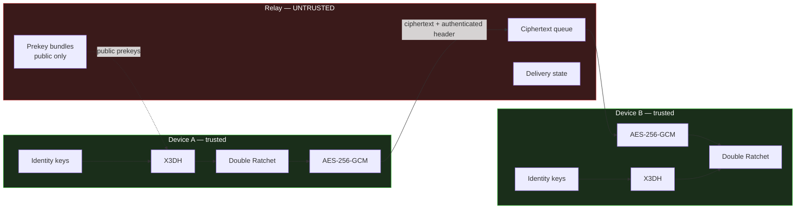

# Helo

**A privacy-first end-to-end encrypted messenger.** It uses a hybrid post-quantum handshake, the Double
Ratchet, and an untrusted relay that only ever holds ciphertext.

Protocol identifier: `Helo/2 PQXDH(X25519 + ML-KEM-768)-SHA256 + DoubleRatchet + AES-256-GCM`

> **Post-quantum at session establishment only.** Every new session uses a hybrid X25519 + ML-KEM-768
> handshake (PQXDH structure), with no silent fallback to classical. The Double Ratchet after it is
> classical. Details and limits: [PROTOCOL.md § 9](PROTOCOL.md) and [SECURITY_CLAIMS.md](SECURITY_CLAIMS.md)
> C15–C16. This implementation has not been independently audited.

---

## A note on the protocol name

The name is not cosmetic. It is embedded in every KDF domain-separation string
(`Helo_X3DH_v1`, `Helo_RootRatchet_v1`, `Helo_MessageKeys_v1`, and so on), so
**changing it changes every key the protocol derives.** Verified: regenerating
the vectors from the identical seed after the rename produced a different root
key, a different message key, and a different X3DH shared secret at every
pinned step.

That is domain separation working correctly — it is what stops key material
from one context being reusable in another. It also means the name is now
frozen: renaming again after any deployment would break every existing session
and invalidate every stored vector. Any future change must go through a
protocol version bump, not a string edit.

---

## Status

This project is being built in the phased order its specification prescribes:
**cryptography first, chat UI last.** A polished UI over an unverified protocol
is the exact failure mode this design is meant to avoid.

| Area | Status |
|---|---|
| Protocol: PQXDH, Double Ratchet, padding, STREAM attachments | ✅ Python reference (normative) and Dart port, pinned by vectors |
| Relay v2: device-bound sending, directory, presence, long-poll, batch, attachments, blocks, reports, settings, security events, account deletion | ✅ zero runtime dependencies |
| Messenger: 1:1 and groups, receipts, typing, replies, reactions, edit, delete, forward, search, pin, archive, mute, disappearing messages, blocking, profiles, per-device verification | ✅ `mobile/lib/domain/` |
| UI: onboarding, chat list, chat, info and security panel, settings, dark mode, phone to 3-pane widths | ✅ checked in the browser (see `docs/IMPLEMENTATION_STATUS.md`) |
| Verification dashboard built from real test runs | ✅ `scripts/verify.py` → `reports/`, also in the app |
| Research experiments (padding, PQ cost, metadata) | ✅ `research/` — measured, not estimated |

**Verification status (run of 2026-10-16, `python scripts/verify.py`): 405/405 tests, 10/10 suites PASS.**

| Component | Executed & verified here? |
|---|---|
| Python reference (unit, adversarial, property, integration) | ✅ 144 + 49 + 18 + 23 passing |
| Test vectors | ✅ reproduce byte-exactly |
| Relay backend | ✅ 45 tests passing |
| Cross-stack end-to-end (PQXDH + database inspection) | ✅ 29 checks passing |
| Dart client (vectors, protocol v2, Messenger and chat UI against the real relay) | ✅ 94 tests passing, `flutter analyze` clean |
| Web client against the real relay | ✅ exercised by hand: two users, groups, reactions, replies, edits, deletes, dark mode, phone width |
| Android / iOS builds | ⚠️ platform projects generated, not built (no Android SDK or macOS here) |

The Dart port is *verifiable*, not asserted correct: `flutter test` replays the
vectors the Python reference generates, and a single differing byte fails it.
Running it caught a real defect the original vectors could not: the Dart safety
number ordered fingerprints by their **base64 text** rather than their bytes,
which disagrees with the reference for roughly a third of identity pairs. A
vector chosen to sort differently under the two rules now pins the behaviour
(`safety_number_ordering` in the vector file).

**What exists today**:
- a verified hybrid-PQ cryptographic core;
- a working untrusted relay;
- a full-featured messenger that runs in the browser against that relay;
- measured privacy and performance experiments;
- documentation, CI and containerised deployment.

**How to run any of it: [RUNNING.md](RUNNING.md).**

---

## Security philosophy

Three commitments shape every design decision here:

1. **Claim nothing that is not tested.** Every security property is mapped to a
   named passing test in [SECURITY_CLAIMS.md](SECURITY_CLAIMS.md). Properties
   that are intended but undemonstrated are listed separately as *not claimed*.

2. **State limitations as prominently as capabilities.** Forward secrecy has two
   real exceptions in this design; both have **dedicated tests asserting the
   exception**, not just a footnote. The relay sees substantial metadata; it is
   enumerated field by field.

3. **Never describe the backend as "zero knowledge."** It is an *untrusted
   ciphertext relay that does not possess plaintext message content or session
   encryption keys.* That is a narrower and truthful statement.

---

## Architecture



The red boundary is the trust boundary. Everything inside it is assumed hostile.

### Protocol layers

```
Identity (Ed25519 sig + X25519 DH)
   └─> X3DH session establishment        [PQXDH-replaceable seam]
         └─> Double Ratchet
               └─> per-message keys
                     └─> AES-256-GCM AEAD
                           └─> ciphertext transport
```

### Cryptographic primitives

| Purpose | Algorithm | Standard |
|---|---|---|
| Key agreement | X25519 | RFC 7748 |
| Signatures | Ed25519 | RFC 8032 |
| Hash | SHA-256 | FIPS 180-4 |
| MAC / chain ratchet | HMAC-SHA-256 | RFC 2104 |
| KDF | HKDF-SHA-256 | RFC 5869 |
| AEAD | AES-256-GCM | NIST SP 800-38D |

No primitive is hand-implemented. `primitives.py` is a thin wrapper over
`cryptography` (OpenSSL bindings); its only original logic is domain
separation, key validation, and an injectable randomness source for
reproducible vectors.

---

## Two deliberate deviations

Both are documented in code with their rationale, because unexplained
deviations from a well-known protocol are how subtle breaks get introduced.

**1. Split identity key.** Signal uses one Curve25519 key for both DH and
signing via XEdDSA. Helo uses `IK_sig` (Ed25519) + `IK_dh` (X25519).
XEdDSA has no mainstream Dart implementation and hand-rolling it would violate
the "no custom primitives" rule; cross-algorithm key reuse is also generally
discouraged. The two halves are bound by a signature, by the fingerprint, and
by the AEAD associated data — substituting either breaks all three at once.

**2. Derived AEAD nonce.** The nonce is derived from the message key via HKDF
rather than randomly generated and transmitted. AES-GCM fails catastrophically
on nonce reuse; with a random nonce that safety depends on the sender's RNG
being healthy at every send, whereas with derivation it depends only on each
message key being used once — which the ratchet guarantees structurally. This
converts a runtime assumption into a structural one and saves 12 bytes per
message.

---

## Repository structure

```
helo/
├── README.md  PROTOCOL.md  SECURITY_CLAIMS.md  RUNNING.md  RESEARCH_METHODOLOGY.md
├── crypto/reference/           NORMATIVE Python protocol implementation
│   └── helo_ref/
│       ├── primitives.py       audited-library wrappers, key validation
│       ├── encoding.py         canonical wire encoding
│       ├── identity.py         identity keys, fingerprints, safety numbers
│       ├── prekeys.py          prekey lifecycle, incl. signed ML-KEM prekeys
│       ├── x3dh.py             classical establishment + KeyEstablishment seam
│       ├── pq.py  pqxdh.py     ML-KEM-768 wrapper; hybrid PQXDH
│       ├── padding.py          length-hiding padding policies
│       ├── attachment.py       STREAM AES-256-GCM file encryption
│       ├── ratchet.py          Double Ratchet
│       ├── message.py          wire envelope + data classification
│       ├── session.py          state machine, downgrade policy, encrypted persistence
│       ├── secure_log.py       allowlist-based redacting logger
│       └── errors.py           fail-closed error taxonomy
├── tests/                      unit 130 · adversarial 49 · property 18 · integration 10
│   └── vectors/                deterministic cross-implementation vectors (+ ML-KEM fixture)
├── scripts/
│   ├── verify.py               runs every suite → reports/verification.json + dashboard.html
│   ├── experiments/            E1 padding, E2 PQ handshake cost, E3 metadata inventory
│   ├── generate_test_vectors.py
│   ├── integration_e2e.py      real relay + real client + database inspection
│   ├── run_demo.py             relay + web client for a local two-user demo
│   └── benchmark.py
├── research/                   EXPERIMENTS.md, METRICS.md, RESULTS.md, results/*.json
├── reports/                    output of scripts/verify.py
├── docs/                       audit, architecture, security model, API, testing, roadmap, status
├── backend/                    relay — ZERO npm dependencies
│   ├── src/server.js http.js context.js db.js auth.js validate.js ratelimit.js log.js
│   ├── src/routes/             auth, devices, prekeys, messages, attachments, social, account
│   └── test/                   relay.test.js + relay_v2.test.js (44 tests)
├── mobile/                     Flutter client
│   ├── lib/crypto/             Dart port of the reference (incl. PQXDH, padding, attachments)
│   ├── lib/protocol/           end-to-end encrypted application payload
│   ├── lib/storage/            CryptoStorage (Keystore / Keychain)
│   ├── lib/data/               relay client (moves ciphertext only)
│   ├── lib/domain/             Messenger — the plaintext boundary; directory, groups, local store
│   ├── lib/ui/                 screens, widgets, theme
│   ├── android/ ios/ web/ windows/   generated platform projects
│   └── test/                   vectors, protocol v2, Messenger + chat UI against the real relay
├── docker/                     hardened deployment + TLS
└── .github/workflows/ci.yml    CI with security gates
```

The Python reference is **normative**. When the Dart client disagrees with it,
the Dart client is wrong. This is why the vectors exist: a second
implementation is rarely wrong in a way that crashes — it is wrong in a way
that derives a *different key* while looking perfectly healthy in isolation.

---

## Setup

Requires Python 3.11+.

```bash
pip install cryptography pytest hypothesis
```

## Testing

```bash
python scripts/verify.py                  # everything below → reports/verification.json + dashboard.html
python -m pytest -q                       # 221 protocol tests
cd backend && npm test                    # 45 relay tests, zero deps
cd mobile  && flutter test                # 94 Dart tests, incl. Messenger + UI against the real relay
```

Details: [docs/TESTING.md](docs/TESTING.md). Experiments: [research/EXPERIMENTS.md](research/EXPERIMENTS.md).

## Security testing

```bash
python3 scripts/generate_test_vectors.py           # regenerate vectors
python3 scripts/generate_test_vectors.py --check   # byte-exact reproducibility
python3 scripts/integration_e2e.py                 # real relay + database inspection
python3 scripts/benchmark.py                       # measured performance
```

`integration_e2e.py` is the one to run if you only run one: it starts the real
relay, drives it with the real client over HTTP, then opens the relay's SQLite
file and scans the raw bytes for plaintext and key material.

## Web demo

```bash
cd mobile && flutter build web && cd ..
python3 scripts/run_demo.py --fresh
```

Starts the relay and serves the Flutter web client on two ports — open
`http://localhost:5000` (Alice) and `http://localhost:5001` (Bob). Each port is
a separate browser origin with its own key storage, so the two tabs are
genuinely different devices. Details in [RUNNING.md](RUNNING.md#4-web-demo).

On a phone: `python scripts/run_demo.py --fresh --lan` serves the app over HTTPS on the Wi-Fi, using a
self-signed certificate that shows a one-time warning. Steps are in RUNNING.md, "On your phone".

## Deployment

```bash
cd docker && RELAY_DOMAIN=relay.example.com docker compose up -d --build
```

Read-only container, non-root, all capabilities dropped, relay off the public
network, TLS terminated by Caddy. See `docker/` and SECURITY.md.

---

## Measured results

Reference implementation, general-purpose machine. **These are not mobile
numbers** and are explicitly disclaimed as such in the benchmark script.

| Operation | Median | p95 |
|---|---|---|
| Identity key generation | 0.17 ms | 0.31 ms |
| Prekey bundle verification | 0.27 ms | 0.43 ms |
| X3DH session establishment | 0.85 ms | 1.25 ms |
| Message encryption (256 B) | 0.023 ms | 0.033 ms |
| Encrypt + decrypt round trip | 1.09 ms | 1.38 ms |
| DH ratchet step (both sides) | 5.66 ms | 6.35 ms |
| 100 one-time prekeys | 4.54 ms | 4.97 ms |

Run-to-run variance on a shared machine is roughly ±20%, so treat these as
*relative* costs — a DH ratchet step is ~250× a symmetric encryption, which is
the number that actually matters for design — not as precise figures.
Regenerate with `python3 scripts/benchmark.py`.

**Ciphertext expansion: constant 57 bytes** (16-byte GCM tag + 41-byte header) across payloads from
0 B to 16 KB. Helo/2 therefore pads before encryption: block-256 by default.

HELO 2.0 measurements are in [research/RESULTS.md](research/RESULTS.md):
- the hybrid handshake costs about 0.2 ms more per side, and the first message is about 1.5 KB larger;
- block-256 cuts length leakage on short messages from 7.6 to 0.33 bits;
- the relay database exposes the who-talks-to-whom graph while messages are queued.

---

## Known limitations

The full list is in [SECURITY_CLAIMS.md](SECURITY_CLAIMS.md). The ones that
matter most:

- **Post-quantum only at session establishment.** The ratchet is classical, the PQXDH instantiation
  has not been formally analysed, and the Dart ML-KEM package has not been audited.
- **Trust On First Use.** Cryptography authenticates keys, not people. A
  first-contact MITM is only detected if users actually compare safety numbers
  out of band.
- **Metadata is exposed.** Padding buckets message sizes, but there is no cover traffic or sealed sender.
  The relay sees who talks to whom and when, and traffic analysis is not defended against.
- **Post-compromise recovery is not automatic.** It requires the compromised
  party to actually send a message.
- **Forward secrecy has two exceptions**: in-flight messages and stored skipped
  keys. Both are asserted by tests.
- **Endpoint compromise defeats everything.** Memory zeroisation is best-effort.
- **Hardware backing is narrower than it sounds.** The Keystore/Keychain
  *wrapping* key is hardware-backed; the identity keys themselves are encrypted
  at rest but must exist in process memory to perform a DH. Spelled out
  precisely in `mobile/lib/storage/crypto_storage.dart`.
- **The Flutter client is verified in the browser, not on phones.** Its crypto
  passes the reference vectors and it has run end to end against the real
  relay as a web app. The Android and iOS builds have not been compiled, and
  on the web, `flutter_secure_storage` keeps keys in browser storage under a
  WebCrypto key — far weaker than a hardware keystore. The web build is a
  demonstration client, not a recommended way to hold real keys.
- **QR scanning is tested in code but not yet with a real camera.** Scanning a contact's code (camera or
  screenshot) checks both directions and verifies only that device on an exact match. The decoder and the
  verdict are tested; the live camera path has not been exercised on a device with a camera.
- **Voice messages and in-app audio/video playback are not yet checked by hand.** Recording,
  encryption, delivery and the player UI are covered by tests. Recording with a real microphone and
  playback in a real browser still need a manual check. On mobile/desktop, playing a file writes a
  temporary plaintext copy that is deleted when the player closes.
- **A reset peer appears as a new, unverified device.** Resetting creates a new device id. The chat
  notes "added a new device. It is not verified", and its trust badge drops to unverified until safety
  numbers are compared again. A *changed* key under an existing device id can only come from a
  misbehaving relay, so that device stays blocked permanently.
- **No push notifications.** Notifications appear only while the app is open.
- **Interoperability with Signal is not claimed** and has not been tested.

---

## Post-quantum design

`x3dh.KeyEstablishment` was the migration seam, and it held. PQXDH (`helo_ref/pqxdh.py`,
`mobile/lib/crypto/pqxdh.dart`) replaced the key agreement without touching `ratchet.py` or `message.py`.
- The ML-KEM-768 shared secret is put into the same HKDF as the classical DH outputs.
- PQ prekeys are signed by the identity key.
- A missing or stripped PQ prekey is refused, never downgraded.

Specification: [PROTOCOL.md § 9](PROTOCOL.md). Claims and tests: [SECURITY_CLAIMS.md](SECURITY_CLAIMS.md)
C15–C16. Next step: a post-quantum ratchet component.

---

## Responsible disclosure

This is a research and portfolio implementation. **It has not been
independently audited and should not be used to protect real communications.**

Report security issues privately rather than via public issue tracker.
