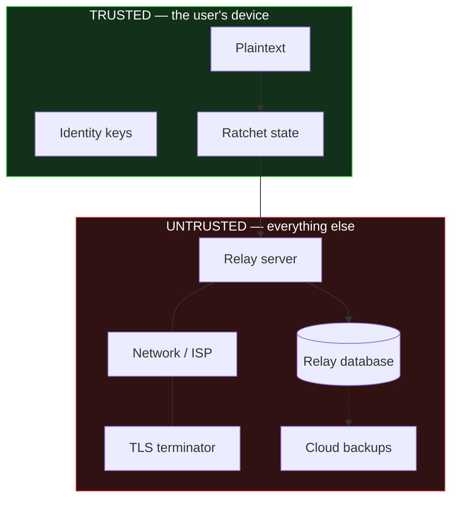

# Threat Model

Each threat below is numbered and referenced by the test that demonstrates the
outcome. Where the outcome is **partial** or **not defended**, it says so.

## Trust boundaries

The trust boundary is the device. Everything outside it is assumed hostile,
including the operator of the relay and the operator of the TLS terminator.

## Attacker capabilities assumed

| Attacker | Capabilities |
|---|---|
| **A1 Passive network** | Observes all traffic; cannot modify |
| **A2 Active network** | Modify, drop, reorder, replay, inject |
| **A3 Malicious relay** | A2, plus full read/write of stored ciphertext and prekeys |
| **A4 Compromised backend** | A3, plus complete historical database dump |
| **A5 State snapshot** | One-time read of a device's full protocol state; passive afterwards |
| **A6 Persistent endpoint** | Ongoing code execution on the device |

---

## T1 — Passive network attacker (A1)

**Expected:** cannot decrypt plaintext.
**Result:** ✅ Content is AES-256-GCM under per-message keys derived on-device.
**Evidence:** `test_relay_database_contains_no_plaintext`; `scripts/integration_e2e.py` §7.
**Residual:** all metadata in T8 remains visible.

## T2 — Ciphertext tampering (A2/A3)

**Expected:** cannot forge or modify a valid authenticated message.
**Result:** ✅ Any single-bit change to ciphertext, tag, or header fails AEAD.
**Evidence:** `test_any_ciphertext_mutation_fails_authentication` (property-based, every bit position); `test_modified_ratchet_public_key_in_header_fails`.
**Note:** rejection is *atomic* — a hostile message cannot desynchronise a live session (`test_tampered_message_does_not_desynchronise_the_session`). Without this, injecting one garbage ciphertext would be a permanent denial-of-service against any conversation.

## T3 — Replay (A2/A3)

**Expected:** a message is accepted at most once.
**Result:** ✅ Three layers — message keys destroyed on use; skipped keys removed on consumption; superseded ratchet keys and consumed counters classified as replay. One-time prekeys destroyed on use.
**Evidence:** `test_no_message_is_ever_delivered_twice` (property-based); `scripts/integration_e2e.py` §10.
**Residual:** if a device's one-time prekeys are exhausted, an initial message could in principle be replayed into a *new* session on the signed prekey alone. Mitigated by relay rate limiting (`test_prekey_fetches_are_rate_limited`) and prompt signed-prekey rotation.

## T4 — Man in the middle (A3)

**Expected:** key substitution is detectable.
**Result:** 🟡 **Partial, and this is the most important limitation in the system.**

Cryptography here authenticates **keys**, not **people**. Signature checks defeat a relay that swaps in its own signed prekey (`test_forged_signed_prekey_signature_is_rejected`) or identity key (`test_substituted_identity_key_is_rejected`), and identity substitution on an established session is refused and flagged (`test_identity_change_on_established_session_is_flagged`).

But **first contact is Trust On First Use.** A relay that intercepts the very first bundle fetch can present its own identity. This is detected *only* if the users compare safety numbers out of band. The app surfaces the state; it cannot force the comparison. `test_full_mitm_produces_a_different_safety_number` demonstrates the mismatch exists — not that anyone looked at it.

## T5 — Compromised backend (A4)

**Expected:** no plaintext, no session keys.
**Result:** ✅ Demonstrated against a *real running relay*, not a mock: `scripts/integration_e2e.py` §7 opens the relay's SQLite file directly and scans the **raw bytes** (including WAL remnants) for the plaintext canary, both identity private keys, the ratchet root key, the ratchet private key, chain keys, the account password, and the auth token. All absent.
**Structural:** the relay imports no protocol code. It cannot perform X3DH, holds no ratchet, and has no AES call anywhere in `backend/src/`.

## T6 — Device state snapshot (A5)

**Expected:** historical confidentiality preserved; future traffic recovers.
**Result:** ✅ with two named exceptions.
- Consumed historical messages are unrecoverable: `test_forward_secrecy_historical_messages_survive_state_compromise`.
- Recovery after a healing round trip: `test_break_in_recovery_after_bidirectional_ratchet`.

**Exceptions, asserted by tests rather than footnoted:**
1. Messages **in flight** (sent, not yet processed) remain decryptable — `test_forward_secrecy_does_not_protect_messages_still_in_flight`.
2. **Stored skipped keys** are decryptable until consumed — `test_skipped_message_keys_are_a_documented_forward_secrecy_exception`. This is the direct cost of out-of-order support, and why `MAX_SKIPPED_KEYS` is bounded.
3. Recovery is **not automatic**: it requires the compromised party to send. If they only receive, exposure continues — `test_no_recovery_without_fresh_entropy_from_the_compromised_side`.

## T7 — Persistent endpoint compromise (A6)

**Expected:** none. **Result:** ❌ **Not defended, and not defensible.**
An attacker executing code as the app reads plaintext before encryption and after decryption, and can ask the platform keystore to unwrap stored keys exactly as the app does. No protocol design mitigates this. Memory zeroisation is best-effort only.

## T8 — Traffic analysis (A1–A4)

**Expected:** metadata is enumerated, not minimised. **Result:** ❌ **Not defended.**

**Observable:** sender and recipient device/account identifiers; session identifiers linking traffic; message timing and frequency; **padded length** (block-256 by default; the leakage is measured in `research/RESULTS.md` E1), and which message starts a session; ratchet cadence and per-chain counts; delivery and read state; which prekeys were consumed and when; IP address and connection timing.

**Not observable:** message content; any session, chain, root, or message key; any private key; safety numbers; verification state.

Padding buckets sizes. No cover traffic or sealed-sender mechanism is implemented. The encrypted payload kind (message, receipt, typing, reaction, edit) is not visible.

## T9 — Resource exhaustion (A2/A3)

**Expected:** bounded work per message.
**Result:** ✅ `MAX_SKIP` (1000/chain) and `MAX_SKIPPED_KEYS` (2000/session) checked *before* derivation; ciphertext capped at parse time; relay body limit and token-bucket rate limits.
**Evidence:** `test_absurd_message_number_is_rejected_not_computed`; `test_login_attempts_are_rate_limited`.

## T10 — Prekey exhaustion / cryptographic downgrade (A2/A3)

**Expected:** downgrade is bounded and visible.
**Result:** 🟡 Draining a victim's one-time prekeys forces three-DH, weakening forward secrecy for first messages. Rate limiting slows it; the relay returns `one_time_prekey_available: false` so the client can **warn** rather than silently accept.
**Evidence:** `test_prekey_exhaustion_is_surfaced_so_the_client_can_warn_about_downgrade`.

## T11 — Malicious TLS terminator

**Expected:** no message confidentiality dependence on TLS.
**Result:** ✅ TLS protects metadata in transit and authenticates the server. It contributes **nothing** to message confidentiality. A fully compromised terminator sees exactly what the relay sees: ciphertext.

## T12 — Account credential compromise

**Expected:** does not yield message content.
**Result:** ✅ Application auth and messaging cryptography are separate concerns in separate modules. A stolen token lets an attacker send and receive *ciphertext* for that account, but grants no ratchet state and no ability to decrypt. It will, however, produce an identity-change warning on the peer's device if they attempt to establish a new session.
